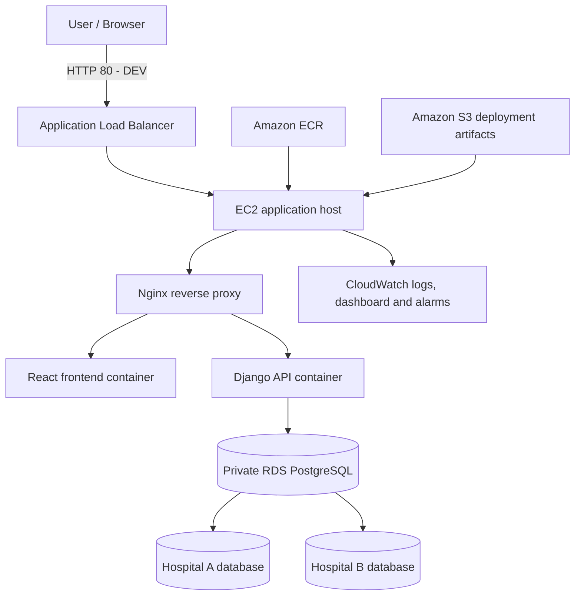

# Healthcare Application – AWS Architecture

## 1. Overview

This proof of concept deploys a sample multi-tenant healthcare application on AWS in the Mumbai region (`ap-south-1`).

Application components:

- React frontend
- Django REST API
- PostgreSQL databases
- Nginx reverse proxy
- Docker containers and Docker Compose
- AWS EC2, Application Load Balancer, RDS, ECR, S3, IAM, VPC, Security Groups and CloudWatch
- Terraform for infrastructure as code
- GitHub Actions for CI/CD

## 2. Deployed architecture

The diagram is a logical view. The two tenant databases are separate PostgreSQL databases configured for the application.

## 3. Network design

- AWS VPC provides network isolation.
- Public subnets host the internet-facing load balancer and the application host as configured in the DEV environment.
- RDS is private and is not directly exposed to the internet.
- Security Groups restrict database access to the application security group.
- Administrative access uses AWS Systems Manager rather than requiring public SSH access.

## 4. Deployment status

| Component | Status |
|---|---|
| AWS Mumbai region | Implemented |
| VPC, subnets and Security Groups | Implemented |
| EC2 application host | Implemented |
| Application Load Balancer | Implemented |
| RDS PostgreSQL | Implemented |
| ECR repositories | Implemented |
| S3 deployment and backup buckets | Implemented |
| CloudWatch dashboard, logs and alarms | Implemented |
| HTTPS with custom domain and ACM | Not implemented; production follow-up |
| Additional AWS regions | Proposed only |
| Site-to-site VPN | Proposed only |

## 5. Application request flow

1. A user sends a request to the DEV Application Load Balancer.
2. The load balancer forwards traffic to the EC2 application host.
3. Nginx routes frontend and API requests to the relevant containers.
4. Django identifies the tenant from the request host.
5. The tenant database mapping selects the corresponding PostgreSQL database.
6. The API returns the response.

The current DEV endpoint uses HTTP. HTTPS must be configured with a domain and certificate before production use.
