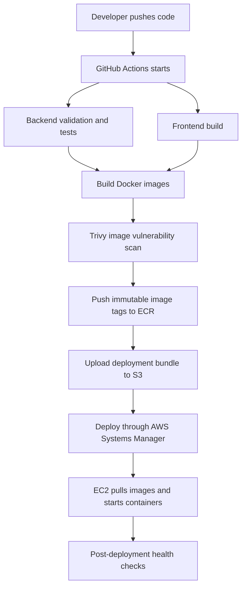

# CI/CD – GitHub Actions

## 1. Pipeline overview

The project uses GitHub Actions to validate the application, build and scan container images, publish images to Amazon ECR, and deploy the DEV application.

## 2. Workflow files

- `.github/workflows/ci.yml`
- `.github/workflows/deploy.yml`
- `.github/workflows/terraform.yml`

Review the workflow YAML files for the exact branch triggers, permissions, environment variables and job conditions.

## 3. Pipeline stages

1. A developer pushes a code change to the configured branch.
2. GitHub Actions runs validation and tests.
3. The frontend is built.
4. Docker images are built.
5. Trivy scans container images.
6. Images are pushed to ECR using immutable build-specific tags.
7. Deployment artifacts are uploaded to S3.
8. AWS Systems Manager runs the deployment steps on the EC2 host.
9. Post-deployment endpoints are checked.

## 4. Authentication and secrets

The deployment pipeline uses GitHub OIDC to assume an AWS IAM role. Avoid long-lived AWS access keys in repository secrets. Configure the minimum required GitHub environment variables and permissions, and never print secret values in workflow logs.

## 5. Environment strategy

| Environment | Purpose | Status |
|---|---|---|
| DEV | Continuous integration and working deployment | Implemented |
| UAT / Staging | Validate release candidates | Not currently provisioned |
| Production | Approved production releases | Not provisioned |

Use separate environment configuration and secrets for each environment. Production should require an approval gate.

## 6. Rollback strategy

Use immutable image tags to identify previously deployed versions. If a deployment fails, stop or reverse the release and manually redeploy the last known-good image tag after checking application and database compatibility.

An induced deployment failure and rollback have not been demonstrated. Do not describe rollback as a tested automated feature unless it has subsequently been verified.

## 7. Verification

Use the GitHub Actions tab to show successful workflow runs. Demonstrate the image tags in ECR and verify the deployed application using the health and tenant endpoints.
