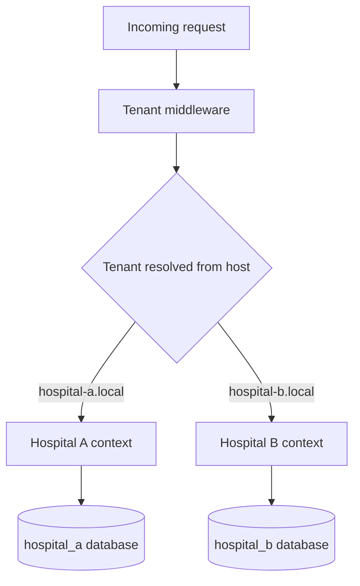

# Multi-Tenant Database Architecture

## 1. Objective

The application demonstrates database-per-tenant isolation for two healthcare organizations.

| Tenant | Organization | Database |
|---|---|---|
| Tenant A | Hospital A | `hospital_a` |
| Tenant B | Hospital B | `hospital_b` |

## 2. Logical architecture

## 3. Tenant identification and database mapping

- Tenant middleware identifies the tenant using the request host/subdomain.
- Tenant configuration maps each tenant to its database connection settings.
- The database router scopes ORM operations to the active tenant.
- Requests with an unknown tenant are rejected.
- Tenant selection is not trusted from an arbitrary request header unless explicitly enabled.

The tenant configuration stores database mapping and environment-variable references, not plaintext database passwords.

## 4. Isolation controls

The application is designed to fail closed when no valid tenant context is available. Tenant-scoped database access prevents a request for one tenant from querying another tenant's database.

Automated tests cover:

- Tenant identification from the request host.
- Unknown-host rejection.
- Tenant database selection.
- Query scoping.
- Cross-tenant list, fetch, update and delete protection.
- Header override restrictions.
- Tenant-specific data storage.

## 5. Verification evidence

The previously completed automated test run passed 12 tenant tests using in-memory SQLite databases. These tests are not tests executed against AWS RDS.

Separately, AWS DEV endpoint checks returned HTTP 200 for Hospital A and Hospital B tenant identification. The application health endpoint reported both tenant databases as available.

Use the screenshots in `screenshots/` as supporting evidence after replacing the placeholders with current captures.

## 6. Credentials and connectivity

- Database credentials are supplied through environment configuration and AWS Secrets Manager.
- Credentials must not be committed to Git.
- RDS is private.
- Database access is restricted to the application security group.
- Database connections use the configured secure connection settings.

## 7. Onboarding another tenant

1. Approve the new organization and assign a unique tenant identifier.
2. Create a separate PostgreSQL database and restricted database user.
3. Store credentials in AWS Secrets Manager.
4. Add the tenant's database mapping and secret/environment references.
5. Configure the tenant hostname.
6. Apply migrations to the new database.
7. Run tenant identification and isolation tests.
8. Verify database connectivity and monitoring.

## 8. Production considerations

Before production, add end-user authentication and authorization, audit logging, stronger tenant onboarding controls, and security testing. This POC uses synthetic sample data and is not a production healthcare system.
