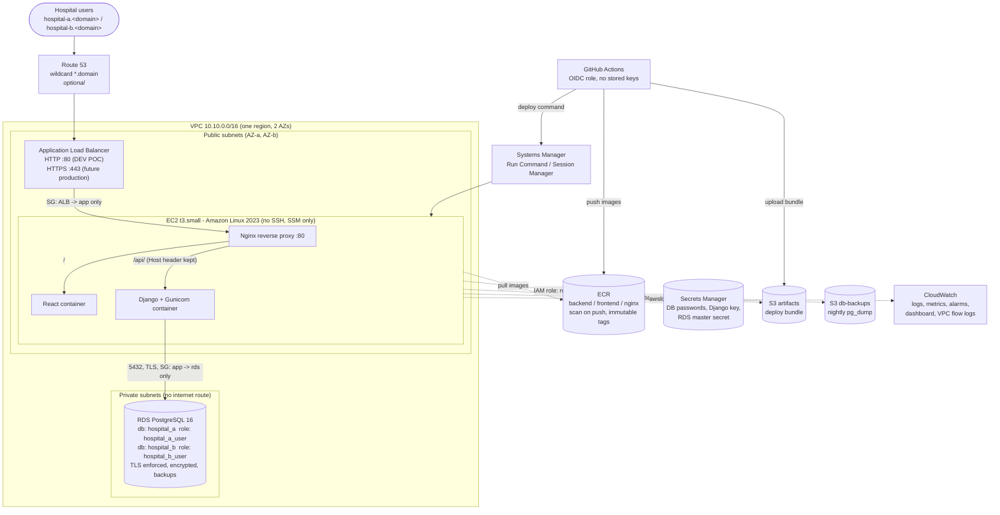

# Cloud architecture (AWS, `ap-south-1` Mumbai)

> **Implemented** = written as code in this repo. **Proposed** = design only (see [implemented vs proposed](../README.md#implemented-vs-proposed)).

## 1. Cloud architecture diagram (implemented)

### Component summary

| Layer | What | Where defined |
|---|---|---|
| Network | VPC, 2 public + 2 private subnets, IGW, route tables, VPC Flow Logs | `terraform/modules/network` |
| Firewall | ALB SG (HTTP 80 for the deployed DEV POC; HTTPS 443 is a future production requirement), App SG (80 from ALB only), RDS SG (5432 from App SG only) | `terraform/modules/security` |
| Compute | One EC2 host running the Compose stack, behind an ALB | `terraform/modules/compute` |
| Database | RDS PostgreSQL 16, private, encrypted, forced TLS, 7-day backups | `terraform/modules/database` |
| Registry | 3 ECR repos, scan-on-push, immutable tags, lifecycle policy | `terraform/modules/ecr` |
| Storage | S3 `artifacts` and `db-backups` (versioned, encrypted, TLS-only, lifecycle) | `terraform/modules/storage` |
| IAM | EC2 instance role (least privilege), GitHub OIDC deploy role per environment | `compute`, `cicd`, `bootstrap` |
| Monitoring | Log group, 11 alarms, SNS topic, dashboard | `terraform/modules/monitoring` |

### Why these choices (POC trade-offs)

* **EC2 + Docker Compose instead of ECS/Fargate**: the same Compose definition runs locally and in the cloud, which keeps the POC small and the local-to-cloud story obvious. ECS Fargate is the natural next step (see [multi-region](multi-region.md#evolution)).
* **No NAT gateway**: saves ~$35/month. The app host is in a public subnet with a public IP for *outbound* pulls only; no inbound rule reaches it except from the ALB. The database subnets have no internet route at all.
* **Single AZ for the app, 2 AZs for the network**: the ALB and DB subnet group span two AZs (required by AWS). Single-AZ compute/DB is a cost decision; production turns on `db_multi_az` and runs ≥2 app hosts (`prod.tfvars`).
* **SSM instead of SSH**: deployment and administration use IAM-authenticated Systems Manager. There is no open management port.

## 2. Request flow

1. Browser requests the DEV ALB HTTP endpoint. Tenant smoke tests send `Host: hospital-a.local` or `Host: hospital-b.local`.
2. The DEV ALB forwards HTTP traffic to Nginx, preserving the `Host` header. HTTPS termination using ACM and a custom domain is a production requirement, not deployed in this POC.
3. Nginx serves the React app for `/` and proxies `/api/` to Django, again keeping `Host`.
4. Django's `TenantMiddleware` resolves `hospital-a` → tenant `hospital_a` and binds it to the request.
5. The database router sends **every** query to `hospital_a`'s own database and role. See [multi-tenant database](multi-tenant-database.md).

## 3. Environments

**DEV:** Provisioned and deployed in AWS Mumbai (`ap-south-1`) using Terraform and GitHub Actions. The application currently uses HTTP and synthetic demonstration data.

**UAT / Staging:** Not deployed. Previously provisioned staging resources have been destroyed to control costs.

**Production:** Not deployed. A production rollout would require HTTPS with ACM, stronger application authentication and authorization, production-grade secrets and data protection, approval gates, and tested rollback procedures.

Only DEV is implemented in AWS for this POC. Staging and Production are documented as future environment configurations. See [CI/CD](ci-cd.md#environment-strategy).
