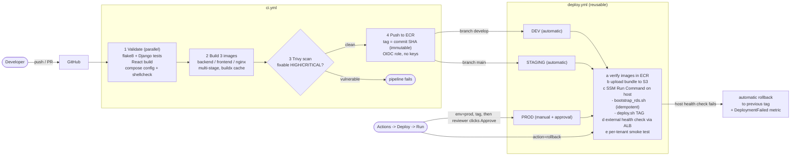

# CI/CD design (GitHub Actions)

Workflow files: [`ci.yml`](../.github/workflows/ci.yml), [`deploy.yml`](../.github/workflows/deploy.yml), [`terraform.yml`](../.github/workflows/terraform.yml).

## Workflow diagram



PRs run steps 1–3 only (nothing is pushed or deployed). `terraform.yml` runs on PRs that touch `terraform/` (fmt, validate, Trivy misconfiguration scan, optional read-only plan commented on the PR).

## Stages in detail

| # | Stage | Detail | Fails the build when |
|---|---|---|---|
| 1 | Backend | `flake8`, `manage.py check`, `makemigrations --check`, isolation tests on SQLite | lint error, missing migration, any test fails (incl. cross-tenant tests) |
| 1 | Frontend | `npm ci` + `vite build` | build error |
| 1 | Config | `docker compose config` for local + server stacks, `shellcheck` | invalid YAML / risky shell |
| 2 | Build | BuildKit with GitHub cache, one matrix job per image | build error |
| 3 | Scan | Trivy on the built image (OS + libraries), CRITICAL/HIGH with a fix available | fixable HIGH/CRITICAL vulnerability |
| 4 | Push | `aws-actions/configure-aws-credentials` via **OIDC**, tag = `${{ github.sha }}`, ECR tags are **immutable** | only on push to `main`/`develop` |
| 5 | Deploy | S3 bundle → SSM Run Command → `deploy.sh` (pull, `up -d`, health check) | host health check fails (then auto-rollback) |
| 6 | Verify | `GET /api/health/` through the ALB (checks **every tenant DB**) + `GET /api/tenant/` per tenant host | non-200 or unhealthy |

Because the tag is the commit SHA and tags are immutable, **what was tested is exactly what runs**, and any version can be redeployed reproducibly.

## Environment strategy

| | Development | UAT / Staging | Production |
|---|---|---|---|
| Trigger | auto on push to `develop` | auto on push to `main` | **manual** `Deploy` run, only from `main` |
| Approval | none | none | GitHub Environment `prod` with **required reviewers** |
| Terraform | `environments/dev.tfvars`, state key `healthcare/dev/…` | `staging.tfvars` | `prod.tfvars` |
| Sizing | t3.small, db.t4g.micro, single-AZ | same as dev | t3.medium+, db.t4g.medium, **Multi-AZ**, 35-day backups, deletion protection |
| Network | `10.10.0.0/16` | `10.20.0.0/16` | `10.30.0.0/16` (non-overlapping so VPC peering/VPN is possible) |
| TLS / DNS | ALB DNS name (HTTP) ok for synthetic data | wildcard cert + domain | wildcard cert + domain, HTTP→HTTPS redirect |
| Data | fictional seed data (`SEED_DEMO_DATA=true`) | anonymised/synthetic | real data only |
| Secrets | own Secrets Manager entries (`healthcare/dev/*`) | `healthcare/staging/*` | `healthcare/prod/*` |
| AWS access | role `healthcare-dev-github-deploy` | `…-staging-…` | `…-prod-…` |

**How configuration is separated**

* *Non-secret, environment-specific values* → `terraform/environments/<env>.tfvars` (reviewed in PRs) and GitHub **Environment variables** (`AWS_DEPLOY_ROLE_ARN`, `INSTANCE_ID`, `ARTIFACTS_BUCKET`, `APP_URL`, `TENANT_HOSTS`, `AWS_REGION`).
* *Secrets* → AWS Secrets Manager only, one set per environment. GitHub holds **no** cloud credentials and no DB passwords.
* *Isolation between environments*: separate VPC, database, secrets, IAM role and Terraform state per environment. Each deploy role's trust policy accepts **only** `repo:<owner>/<repo>:environment:<env>` — so a dev job cannot assume the prod role, and a prod job cannot start until the environment's reviewers approve.
* For stronger isolation production moves to a **separate AWS account** (the shared ECR then uses cross-account pull permissions or replication).

## Production approval

1. Release owner runs **Actions → Deploy → environment `prod`, image tag = the SHA that is already running well in staging**.
2. The job pauses at the `prod` environment (**Settings → Environments → prod → Required reviewers**; also restrict deployment branches to `main` and add a wait timer if desired).
3. A reviewer who is not the requester approves; only then does the job receive OIDC credentials for the prod role.
4. The run summary records who deployed which SHA when (audit trail); the host records the tag in SSM `/healthcare/prod/image_tag`.

## Rollback strategy

| Situation | What happens |
|---|---|
| New version fails its health check on the host | `deploy.sh` automatically redeploys the previous tag, emits `DeploymentFailed` (CloudWatch alarm → SNS), and exits non-zero so the pipeline is red. The previous version keeps serving traffic apart from the brief restart. |
| Problem found after a *successful* deploy | Run **Deploy → action=rollback** (reads `/healthcare/<env>/previous_image_tag`), or deploy any older SHA explicitly. Takes ~2 minutes; no rebuild required because images are immutable and retained (last 20). |
| Bad database migration | Migrations should be **backward compatible** (expand → deploy → contract) so the old image still runs on the new schema. For a destructive mistake, restore from RDS point-in-time recovery or the tenant `pg_dump` into a new database with `restore.sh`, then cut over. Application rollback does not undo schema changes. |
| Bad infrastructure change | Revert the Terraform commit and re-apply; state is versioned in S3 so a previous state file can be recovered. |

## Setting it up (one time)

```text
GitHub repo -> Settings -> Environments: create dev, staging, prod
  Variables on each environment:
    AWS_REGION, AWS_DEPLOY_ROLE_ARN (terraform output github_deploy_role_arn),
    INSTANCE_ID, ARTIFACTS_BUCKET, APP_URL, TENANT_HOSTS
  prod only: Required reviewers, deployment branches = main
GitHub repo -> Settings -> Secrets and variables -> Actions -> Variables (repository):
    AWS_REGION, AWS_ECR_PUSH_ROLE_ARN (bootstrap output), TF_PLAN_ROLE_ARN, TF_STATE_BUCKET
```

No GitHub *secrets* are needed at all.
