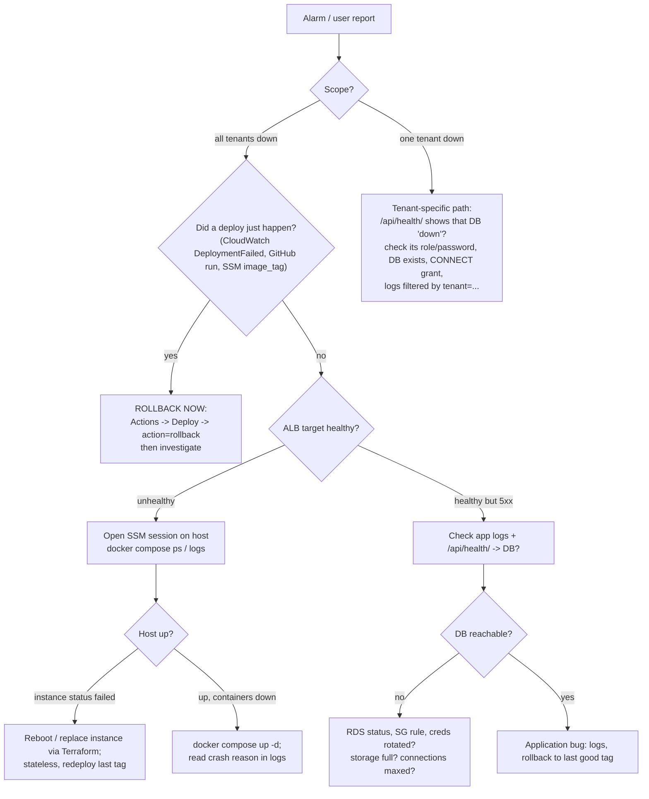

# Monitoring, logging and troubleshooting

## What is monitored (implemented in `terraform/modules/monitoring`)

| Requirement | Signal | Where to see it | Alert |
|---|---|---|---|
| Application health endpoint | `GET /api/live/` (process up) and `GET /api/health/` (every tenant DB reachable, `503` if any is down) | ALB target health; curl in every deploy | `…-alb-unhealthy-targets` (live check failing) |
| Container logs | Nginx, Gunicorn, Django → Docker `awslogs` → `/healthcare/<env>/containers`; Django lines carry `tenant=<id>` | CloudWatch Logs / Logs Insights; dashboard widget "Recent application errors" | metric filter counts `ERROR`/`Traceback` → `…-application-errors` (>20 / 5 min) |
| CPU and memory | EC2 `CPUUtilization`; **memory and disk** from the CloudWatch agent (`CWAgent`) | Dashboard `healthcare-<env>` | `…-ec2-cpu-high` (>80 %), `…-memory-high` (>85 %, missing data = breach), `…-disk-high` (>80 %) |
| Database connectivity | `/api/health/` per tenant; RDS `DatabaseConnections`, `CPUUtilization`, `FreeStorageSpace` | Dashboard + Insights | `…-rds-cpu-high`, `…-rds-free-storage-low` (<2 GiB), `…-rds-connections-high`; unreachable DB → `/api/health/` 503 → failed deploy check |
| Deployment status | `deploy.sh` emits `Healthcare/DeploymentSucceeded` and `DeploymentFailed`; SSM parameters `/healthcare/<env>/image_tag` and `previous_image_tag`; GitHub run summary | CloudWatch metrics, GitHub Actions | `…-deployment-failed` |
| Host / 5xx | `HTTPCode_Target_5XX_Count`, `StatusCheckFailed` | Dashboard | `…-alb-target-5xx` (>10 / 5 min), `…-ec2-status-check-failed` |
| Network | VPC Flow Logs → `/healthcare/<env>/vpc-flow-logs` | Logs Insights | — (investigation tool) |

All alarms notify the SNS topic `healthcare-<env>-alerts`. Set `alert_email` in tfvars and **confirm the subscription e-mail**. Production would add a paging integration (PagerDuty/Opsgenie) and ticketing.

Useful Logs Insights queries:

```text
# errors per tenant, last hour
fields @timestamp, @message
| filter @message like /ERROR|Traceback/
| parse @message "tenant=* " as tenant
| stats count() by tenant

# slow / failing API calls (nginx access log)
fields @timestamp, @message | filter @message like / 5\d\d / | sort @timestamp desc | limit 50

# rejected network traffic to the database subnet (flow logs)
fields @timestamp, srcAddr, dstAddr, dstPort, action
| filter action = "REJECT" and dstPort = 5432 | sort @timestamp desc | limit 50
```

Local equivalents: `make logs`, `make ps` (Compose health status), `curl localhost/api/health/ -H 'Host: localhost'`.

## Investigating an application outage — runbook

**Goal: stop the bleeding first, find root cause second.**



### Step by step

1. **Confirm and scope** (2 min). Open the dashboard `healthcare-<env>`. Is it all tenants or one? `curl -s https://<app>/api/health/` — the JSON tells you which tenant databases are `up`/`down`.
2. **Recent change?** Check CloudWatch `DeploymentFailed`, the latest GitHub Actions run, and the SSM parameter `/healthcare/<env>/image_tag`. If an outage started right after a deploy → **roll back first** (Actions → Deploy → `rollback`), debug afterwards.
3. **Edge**: ALB → Target groups → target health. `Unhealthy` means the `/api/live/` check fails: the host or Nginx/Django container is not answering. `Healthy` with 5xx means the app is up but erroring.
4. **Host**: `aws ssm start-session --target <instance-id>` (no SSH needed), then:
   ```bash
   cd /opt/healthcare && sudo docker compose -f docker-compose.prod.yml ps        # state + health
   sudo docker compose -f docker-compose.prod.yml logs --tail=100 backend
   df -h /; free -m; uptime                                                       # disk/memory pressure
   ```
5. **Database**: from the host (the only place that can reach it):
   ```bash
   source /opt/healthcare/static.env
   pg_isready -h "$DB_HOST" -p 5432                    # network + server accepting?
   # TLS + tenant credentials (values come from Secrets Manager, not from your shell history):
   PGSSLMODE=require PGPASSWORD=… psql -h "$DB_HOST" -U hospital_a_user -d hospital_a -c 'select 1'
   ```
   Also check: RDS status/events, `FreeStorageSpace`, `DatabaseConnections`.
6. **Network**: Security-group rule app→rds on 5432 still present? Flow Logs query for `REJECT` to port 5432. Did DNS / certificate (ACM) expire?
7. **Fix and verify**: roll back / restart / restore, then run `scripts/isolation_demo.sh` against the environment to confirm each tenant is healthy and still isolated.
8. **Close out**: timeline, root cause, follow-up actions (blameless post-mortem); add an alarm or test so the same failure is caught earlier.

### Basic connection troubleshooting cheat-sheet (PostgreSQL)

| Symptom | Likely cause | Check / fix |
|---|---|---|
| `connection timed out` | Security group / route / wrong host | app SG → RDS SG on 5432; `DB_HOST` value; Flow Logs REJECT |
| `no pg_hba.conf entry … no encryption` | TLS required on RDS but client `sslmode=disable` | set `DB_SSLMODE=require` |
| `password authentication failed for user "hospital_a_user"` | Secret rotated / env not re-rendered | re-run **Deploy** (re-renders env and `bootstrap_rds.sh` re-applies password) |
| `permission denied for database "hospital_b"` | **Expected** when a role tries another tenant's DB; unexpected if the app uses the wrong alias | verify tenant mapping in `tenants.json` |
| `database "hospital_c" does not exist` | New tenant added but not provisioned | run `bootstrap_rds.sh`, then `migrate_tenants` |
| `FATAL: too many connections` | connections × workers × tenants too high | lower Gunicorn workers, add PgBouncer/RDS Proxy, bigger instance |
| `/api/health/` 503 but `/api/live/` 200 | App fine, ≥1 tenant DB unreachable | read the `databases` object to see which |
| Django `DisallowedHost` / 400 | host not in `DJANGO_ALLOWED_HOSTS` | add the domain; remember ALB probes use `Host: localhost` via Nginx |
