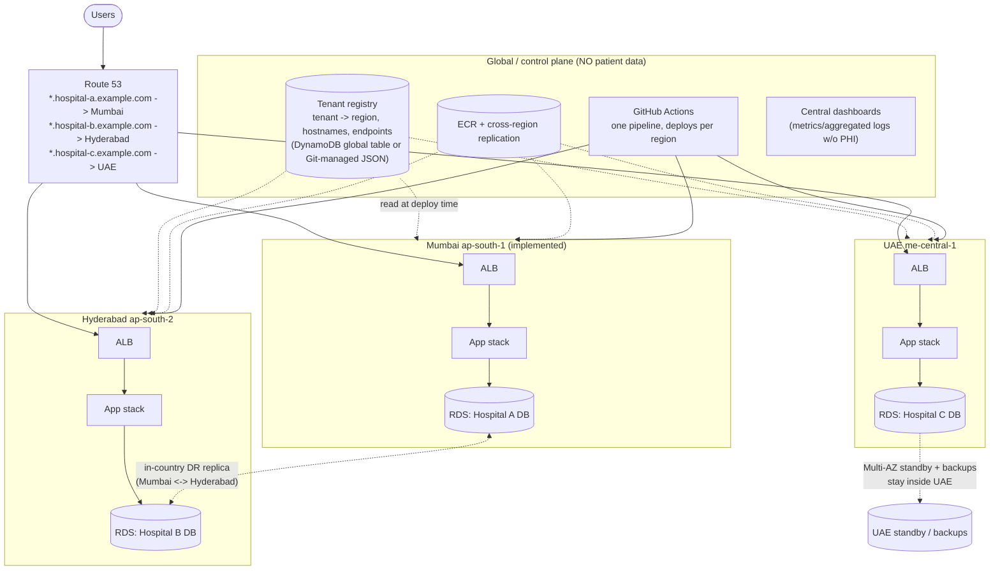

# Multi-region design proposal (PROPOSED — one region implemented)

Implemented: a single region (Mumbai, `ap-south-1`). Everything below is a design for adding **Hyderabad** (`ap-south-2`) and **UAE** (`me-central-1`). The code already contains the hooks that make this incremental: a `region` field and per-tenant `host_env` in `tenants.json`, region-parameterised Terraform (`aws_region`, per-environment tfvars, per-region state key), and per-region secrets/buckets named by environment.

> Example from the brief: Mumbai → Hospital A, Hyderabad → Hospital B, UAE → Hospital C. On AWS the corresponding regions are Mumbai `ap-south-1`, Hyderabad `ap-south-2` and UAE `me-central-1`; confirm current regional service availability and any opt-in requirements before committing.

## Target architecture

**Core principle: a tenant's data lives in exactly one *residency zone* and each region runs a full, independent application stack.** Regions share code and configuration, never patient data.

## 1. How tenants are assigned to regions

* Assignment is a **contract/compliance decision made at onboarding**, recorded in the tenant registry (`region: "ap-south-2"`), and is effectively immutable (moving a tenant = a planned data migration).
* Each tenant gets region-local hostnames. Two options:
  1. **Per-tenant DNS records** (`hospital-b.example.com` → Hyderabad ALB). Simplest; what the current sub-domain routing already expects.
  2. **Global entry + geo router**: a thin global layer (CloudFront/Global Accelerator) looks up the tenant → region and forwards. Adds a dependency on the control plane for every request, so only use it if single hostnames per tenant are required.
* **No cross-region queries.** Each regional deployment should only load **its own** tenants from the registry. *Proposed change (not implemented):* a `REGION` environment variable that makes `load_tenants()` skip entries whose `region` differs — a ~5-line change — so a request reaching the wrong region returns `404`, not another hospital's data.
* Tenant list, hostnames and DB endpoints are the only global metadata; it contains no PHI.

## 2. Regional database connectivity

* Each region has its **own VPC, private subnets and RDS instance** (same Terraform modules, new tfvars/state key: `environments/prod-hyderabad.tfvars`).
* The application connects **only to its in-region database** over private IPs with TLS and the per-tenant role. No application traffic crosses regions.
* The `host_env` field per tenant means a tenant can be pointed at a different endpoint (e.g. a dedicated RDS for a large customer) without code changes.
* Connection pooling (PgBouncer/RDS Proxy) per region once tenant count grows.

## 3. Backups and disaster recovery

| | Strategy |
|---|---|
| In-region HA | RDS **Multi-AZ** (synchronous standby in another AZ), ≥2 app hosts/tasks behind the ALB across AZs. RTO minutes, RPO ≈ 0 |
| Backups | RDS automated backups + PITR (35 days in prod) + nightly per-tenant `pg_dump` to versioned S3 (`backup.sh`). **Restore tests** monthly with `restore.sh` into a throw-away database |
| Regional DR | Choose per tenant, **within its residency zone**: Mumbai ⇄ Hyderabad are both in India, so an in-country cross-region read replica / snapshot copy is allowed. UAE has, as far as I know, no second in-country AWS region (verify current availability) → DR stays **multi-AZ + in-country backups**, or use a customer-approved alternative |
| DR runbook | Promote replica (RPO seconds-minutes) → point the tenant's DNS record at the DR region's stack (pre-built, scaled-down "pilot light" via Terraform) → verify with `/api/health/` and the isolation demo. RTO target 1–2 h |
| Targets (proposal) | Tier-1 tenants: RPO ≤ 5 min, RTO ≤ 1 h. Standard: RPO ≤ 24 h (nightly dump), RTO ≤ 4 h. To be agreed per contract |
| Immutability | S3 versioning (+ Object Lock for ransomware resilience), backups encrypted with per-region KMS keys |

## 4. Data residency

* **Residency zone** per tenant (India, UAE, …) is stored in the registry and **enforced by guardrails**, not just convention:
  * AWS Organizations **SCPs** deny creating data stores (RDS, S3, EBS snapshots) outside approved regions per account; one AWS account per residency zone is the cleanest boundary.
  * Cross-region replication, snapshot copy and S3 replication rules are **allow-listed** per zone (India↔India only; UAE stays in UAE).
  * Terraform validates `region ∈ allowed_regions[zone]` before applying.
* **What may cross borders**: code, container images, non-PHI configuration, aggregated/anonymised metrics. **What may not**: patient records, backups, database logs, support exports, and application logs that contain PHI.
* Logs: keep application logs in-region (CloudWatch per region); ship only scrubbed metrics to the central dashboards. The Django log format already carries only `tenant=<id>`, never patient fields.
* Operational access: break-glass access to a region's data is granted via region-scoped IAM roles with session logging; support staff in another country do not get standing access.
* Legal mapping (to be confirmed with counsel): India DPDP Act 2023 and sector rules (e.g., ABDM), UAE Federal Law No. 2 of 2019 (health data) and PDPL. This document is architecture, not legal advice.

## 5. Securing cross-region communication

Application traffic does not cross regions by design. The remaining cross-region flows are control-plane and DR:

| Flow | Protection |
|---|---|
| CI/CD → each region | OIDC-assumed **per-region, per-environment role**; SSM Run Command (no inbound access); images pulled from the regional ECR replica |
| Registry/config reads | HTTPS + IAM; non-PHI |
| DB replication (Mumbai ⇄ Hyderabad) | Managed by RDS over the AWS backbone, encrypted (KMS multi-region or per-region keys); no public endpoints |
| If private connectivity between regional VPCs is ever needed | **Inter-region VPC peering or Transit Gateway peering** (encrypted on the AWS backbone, non-overlapping CIDRs — already reserved: dev 10.10, staging 10.20, prod 10.30, further regions 10.31/10.32…), security-group rules limited to specific ports; or a site-to-site VPN mesh as a fallback |
| Hospital → region | Per-hospital Site-to-Site VPN to the **tenant's own region** only ([VPN design](vpn.md)) |
| Observability | Metrics/alarms to a central account via CloudWatch cross-account/cross-region observability — PHI-free |

## Evolution

1. Today: single EC2 host + RDS (this POC).
2. Next: ECS Fargate services + RDS Proxy per region (no hosts to patch, rolling deployments, blue/green via CodeDeploy), WAF on the ALB.
3. Then: per-region AWS accounts under one Organization, Control Tower guardrails, centralised logging account.
4. If tenant count grows beyond ~100 per region: move small tenants to schema-per-tenant pools while keeping database-per-tenant for regulated/large ones (routing already abstracts this).
