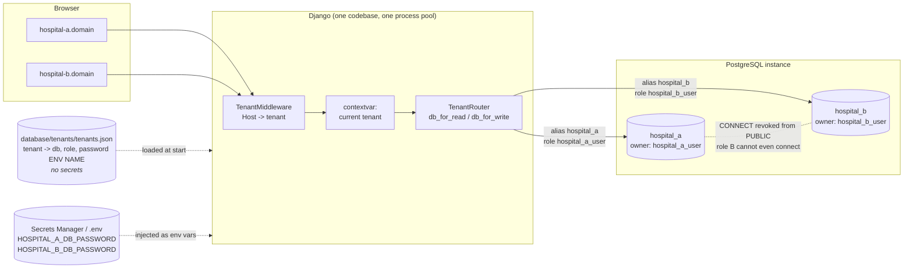

# Multi-tenant database architecture

**Model: database-per-tenant.** Each hospital has its own PostgreSQL database *and* its own login role. The strongest isolation guarantee in this design comes from PostgreSQL itself, not from application code.

## Diagram



## How the requirements are met

### 1. Tenant identification
`backend/tenants/middleware.py` resolves the tenant from the **sub-domain of the Host header** (`hospital-a.example.com` → `hospital_a`). Unknown hosts get `404`. The `X-Tenant-ID` header exists for local `curl` only and is honoured **only** when `ALLOW_TENANT_HEADER=true`; it is `false` in AWS (`docker-compose.prod.yml` forces it) and can never override a sub-domain. `ALLOWED_HOSTS` additionally restricts which domains Django accepts at all.

### 2. Tenant → database mapping
`database/tenants/tenants.json` (non-secret, committed):

```json
{ "id": "hospital_a", "subdomain": "hospital-a", "region": "ap-south-1",
  "db": { "name": "hospital_a", "user": "hospital_a_user",
          "password_env": "HOSPITAL_A_DB_PASSWORD", "host_env": "DB_HOST" } }
```

`settings.py` turns each entry into a Django `DATABASES` alias. `TenantRouter` sends every read and write to the alias of the tenant bound to the current request. `host_env` lets a tenant point at a different database host, which is how regional databases plug in later.

### 3. Tenant A cannot access Tenant B's data — four independent layers

| Layer | Mechanism | Evidence |
|---|---|---|
| Routing | Router sends queries to the tenant's own DB; the model has **no `tenant_id` column to forget to filter** | `patients/tests.py::test_data_is_stored_in_the_tenants_own_database` |
| Fail closed | With no tenant bound, the router **raises** instead of using a shared DB | `test_query_without_tenant_fails_closed` |
| API | B requesting A's record id → `404`; PATCH/DELETE → `404` | `test_tenant_b_cannot_fetch_update_or_delete_tenant_a_record_by_id` |
| Database | `REVOKE ALL ON DATABASE … FROM PUBLIC`; each role can only connect to its own DB | `scripts/isolation_demo.sh` step 5 |

Result of the database-layer check (real PostgreSQL 16, run during development of this POC):

```
$ psql -U hospital_a_user -d hospital_b -c 'select 1'
FATAL:  permission denied for database "hospital_b"
DETAIL:  User does not have CONNECT privilege.
```

Even a full compromise of the Django process for tenant A (SQL injection, router bug) is limited by what `hospital_a_user` can reach — but note the app process *holds both passwords* (see limitations).

Run it yourself: `make test` (automated tests) and `make isolation-demo` (live against the stack).

### 4. Secure credential storage

| Where | How |
|---|---|
| Git | Only the **names** of environment variables (`password_env`). `.env` is git-ignored; `.env.example` has placeholders |
| Local | `.env` file → Compose `environment:` (only the variables each service needs) |
| AWS | Terraform generates 32-char random passwords → **Secrets Manager** (`healthcare/<env>/tenant-db-credentials`). The EC2 role may read only those secrets; `render_env.sh` writes a root-only (`0600`) env file at deploy time. The RDS master password is **RDS-managed** (`manage_master_user_password`) and never appears in code or state |
| CI | GitHub Actions never sees DB passwords (deploys via SSM; the host fetches secrets itself) |

### 5. Onboarding a new tenant (e.g. `hospital_c`)

1. **Add the mapping** in `database/tenants/tenants.json`:
   ```json
   { "id": "hospital_c", "name": "Hospital C", "subdomain": "hospital-c",
     "db": { "name": "hospital_c", "user": "hospital_c_user",
             "password_env": "HOSPITAL_C_DB_PASSWORD", "host_env": "DB_HOST" } }
   ```
2. **Add the secret**: in `terraform/variables.tf` (or tfvars) add `hospital_c = "HOSPITAL_C_DB_PASSWORD"` to `tenants`, then `terraform apply` → a new random password is added to the Secrets Manager secret.
3. **Open a pull request** → CI tests and builds an image containing the new mapping.
4. **Deploy**. The deploy step runs `bootstrap_rds.sh` (creates the `hospital_c` database + role, locks `CONNECT`) and the container entrypoint runs `migrate_tenants` (creates the schema).
5. **DNS**: nothing to do with a wildcard record; otherwise add `hospital-c.<domain>`.
6. **Verify** with `scripts/isolation_demo.sh` and check `/api/health/` lists `hospital_c: up`.

Locally: add the entry + `HOSPITAL_C_DB_PASSWORD` to `.env`, add the line to `database/init/01-provision-tenants.sh`, `make reset && make up`.

Offboarding: take a final `backup.sh`, drop the database/role, remove the mapping and secret. The data never mixed with other tenants, so deletion is a single `DROP DATABASE` — a real benefit of this model for data-erasure obligations.

## Trade-offs and limitations (be honest in the walkthrough)

* **Database-per-tenant scales to tens or low hundreds of tenants** per instance/pool. Thousands of tenants would need schema-per-tenant or sharding, plus pooling (PgBouncer). Each Gunicorn worker holds up to one connection per tenant.
* The app process **holds every tenant's password** in one place, so a full app-server compromise still exposes all tenants. Mitigations in production: one process pool per tenant group, or fetch credentials just-in-time from Secrets Manager / IAM database authentication.
* **No end-user authentication** in this POC (the brief says full healthcare functionality is not required). Production needs per-tenant authentication (OIDC/JWT whose tenant claim must equal the resolved tenant) and audit logging of PHI access.
* Migrations run at container start; with more than one backend replica move `migrate_tenants` into a one-off deploy job.
* The sample data is fictional; real PHI requires a BAA/regional compliance review beyond this POC.
