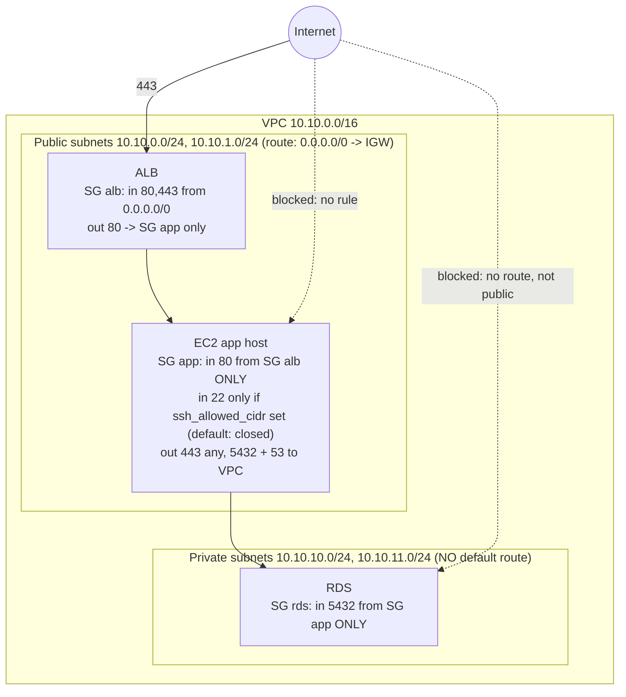

# Security and networking

## Network design

| Control | Implementation |
|---|---|
| Public / private separation | ALB + app host in public subnets; database in private subnets with a route table that has **no** internet route; RDS `publicly_accessible = false` |
| Firewall (Security Groups) | Rules reference **security groups, not IP ranges**: internet → ALB → app → RDS. Nothing else is open. Egress is also restricted (443 out, 5432/53 inside VPC) |
| SSH access | **Closed by default.** Administration and deployment use SSM Session Manager / Run Command (IAM-authenticated, logged). If SSH is ever required, `ssh_allowed_cidr` accepts one `/32` — never `0.0.0.0/0` |
| Host hardening | IMDSv2 required, encrypted EBS, Amazon Linux 2023 base, containers run as non-root, Nginx hides version and sets `X-Content-Type-Options`, `X-Frame-Options`, `Referrer-Policy` |
| HTTPS | ACM certificate on the ALB with TLS 1.2/1.3 policy (`ELBSecurityPolicy-TLS13-1-2-2021-06`); HTTP listener **redirects to HTTPS** when `certificate_arn` is set; Django trusts `X-Forwarded-Proto` and can force SSL (`DJANGO_SECURE_SSL_REDIRECT`). Without a domain the demo runs HTTP on the ALB name — **synthetic data only** |
| Database in transit | `rds.force_ssl = 1` on the server; backend connects with `sslmode=require` |
| Encryption at rest | RDS storage, EBS root volume, S3 (SSE-S3), ECR (AES-256), Secrets Manager |
| Database access restrictions | (1) private subnet, (2) SG only from the app SG, (3) per-tenant role that can `CONNECT` only to its own DB, (4) TLS required, (5) master user used only by the bootstrap script |
| Rate limiting | Nginx `limit_req` 20 req/s per client IP on `/api/` |

## IAM least privilege

| Principal | Allowed | Notably **not** allowed |
|---|---|---|
| EC2 instance role | Pull from the 3 ECR repos; `GetSecretValue` on its 3 environment secrets; read deploy bundle / write DB backups in its 2 buckets; read/write `/healthcare/<env>/*` SSM parameters; write its container log group; `PutMetricData` in namespaces `CWAgent`/`Healthcare`; SSM core | other secrets, other buckets, other environments, IAM, EC2 management |
| GitHub deploy role (per env) | Upload bundle, `ssm:SendCommand` on **that one instance** and `AWS-RunShellScript`, read command result, read/write that env's SSM params, `ecr:DescribeImages` | create/destroy infrastructure, read secrets, touch other environments. Trust is limited to the repo **and** environment name |
| GitHub ECR-push role | ECR push to `healthcare-*` repos; trust limited to branches `main`/`develop` | pull requests from forks cannot assume it |
| GitHub Terraform-plan role | `ReadOnlyAccess` + state bucket | any change to infrastructure |
| VPC Flow Logs role | write to one log group | everything else |

No IAM users or long-lived access keys exist anywhere in this design — GitHub authenticates with short-lived **OIDC** tokens.

## Secrets management

* **Never in Git**: `.gitignore` excludes `.env`, `*.tfvars` named `terraform.tfvars`, state files, keys. `tenants.json` stores only env-var *names*.
* **Local**: `.env` (from `.env.example`).
* **AWS**: Secrets Manager; random values generated by Terraform; RDS master password managed by RDS itself; fetched on the host at deploy time into a `0600` file; passed to containers as environment variables.
* **Caveat**: Terraform `random_password` values exist in Terraform state, so the state bucket (`bootstrap/`) is private, versioned, encrypted, and only admin/plan roles can read it. A hardened setup would generate the values outside Terraform or rotate them on first boot.
* **Rotation**: change a value in Secrets Manager, run **Deploy** (re-renders env, `bootstrap_rds.sh` re-applies the password with `ALTER ROLE`). Automatic rotation with a Lambda is a documented next step.

## Network and application logging

| Source | Destination | Retention |
|---|---|---|
| VPC Flow Logs (all traffic, ACCEPT + REJECT) | CloudWatch `/healthcare/<env>/vpc-flow-logs` | 14 days (var) |
| Container stdout/stderr (Nginx access, Gunicorn, Django with `tenant=<id>` on each line) | CloudWatch `/healthcare/<env>/containers` via Docker `awslogs` driver | 14 days (var) |
| RDS PostgreSQL log (+ `log_connections`) | CloudWatch Logs export | RDS default |
| ALB access logs | *proposed* (S3 bucket + policy) | — |
| API calls | *proposed*: CloudTrail organisation trail (not part of this stack) | — |

## Threats considered

| Threat | Mitigation |
|---|---|
| Tenant data leakage via application bug | DB-per-tenant + router that fails closed + DB-level `CONNECT` restriction + tests in CI |
| Host header / tenant spoofing | `ALLOWED_HOSTS`; header-based tenant selection disabled outside local dev |
| Stolen CI credentials | No stored credentials; OIDC trust bound to repo + environment; prod needs reviewer approval |
| Vulnerable dependencies/images | Trivy gate in CI, ECR scan-on-push, Dependabot |
| Lost/compromised host | No data on the host (stateless containers); recreate via Terraform + redeploy; SSM audit trail |
| Accidental data loss | RDS PITR + nightly per-tenant dumps in versioned S3; deletion protection in prod |

## Known gaps (explicitly out of scope for the POC)

WAF in front of the ALB, GuardDuty/Security Hub, customer-managed KMS keys, IAM database authentication, PgBouncer, end-user authentication/authorisation, PHI access audit trail, and compliance mappings (HIPAA / India DPDP Act / UAE PDPL).
