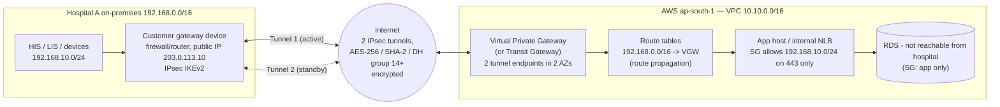

# Site-to-site VPN: on-premises hospital network ↔ AWS (PROPOSED — not provisioned)

Use case: a hospital's internal systems (HIS/LIS/PACS gateways, lab devices) must exchange data with its tenant backend **without traversing the public internet** and without exposing the hospital network to the internet.

## Diagram

## Components and design decisions

| Item | Decision |
|---|---|
| AWS side | **Virtual Private Gateway** attached to the VPC (single VPC). With several VPCs/regions/hospitals use **Transit Gateway** with a VPN attachment per hospital |
| Customer side | **Customer Gateway** resource with the hospital firewall's public IP; hospital firewall must support IPsec (IKEv2 preferred) — AWS provides vendor-specific config downloads |
| Resilience | Every AWS Site-to-Site VPN has **two tunnels** in different AZs; hospital configures both (active/standby via BGP, or ECMP on a Transit Gateway). Second VPN/second ISP for critical hospitals |
| Routing | **Dynamic (BGP)** preferred: hospital ASN ↔ AWS side, routes propagated to the VPC route tables; static routing (`192.168.0.0/16`) acceptable for small sites |
| Addressing | CIDRs **must not overlap** (`10.10/16`, `10.20/16`, `10.30/16` reserved for AWS environments; hospitals use their own range or are NAT-translated at the customer firewall) |
| Encryption | IPsec: AES-256-GCM, SHA-2, DH group 14+ (or 20/21), PFS enabled; pre-shared keys generated by AWS and stored in Secrets Manager (never in Git); certificate-based auth (ACM Private CA) for higher assurance |
| Authorisation | Security groups allow **only the hospital's subnet, only on the needed port (443)**, only to the integration endpoint — not to RDS and not to other tenants' endpoints |
| Tenant isolation | One VPN (and one dedicated route/attachment) **per hospital**; with Transit Gateway use separate route tables so Hospital A's network cannot reach Hospital B's attachment |
| Region | The VPN terminates in **the tenant's own region** (data residency) |
| Monitoring | CloudWatch `TunnelState` and `TunnelDataIn/Out` alarms; VPN logs to CloudWatch; flow logs on the VPC |
| Terraform sketch | `aws_vpn_gateway`, `aws_customer_gateway`, `aws_vpn_connection`, `aws_vpn_gateway_route_propagation` (+ `aws_ec2_transit_gateway_*` for TGW) |

## Rollout steps

1. Exchange network details with the hospital (public IP of their gateway, internal CIDR, BGP ASN, required ports).
2. Terraform: create the Customer Gateway and VPN connection; download the vendor configuration.
3. Hospital network team applies the configuration and brings up both tunnels.
4. Enable route propagation; add the narrow security-group rule; test with `curl https://<internal-endpoint>` from the hospital subnet.
5. Alarm on tunnel state; document the failover test result.

## Alternatives considered

* **AWS Direct Connect** — dedicated, predictable latency; weeks of lead time and higher cost; recommended for large hospital groups, with VPN as backup.
* **Client VPN / SSM / bastion for staff access** — different problem (people, not systems).
* **Application-level mutual TLS over the internet** — valid for modern HL7 FHIR APIs, but legacy HL7 v2/DICOM links generally require a network-level tunnel.
